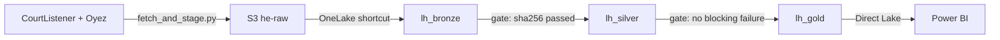

# Hearing Evidence (Microsoft Fabric POC)

[](https://github.com/spykeshivam/hearing-evidence-fabric/actions/workflows/ci.yml)

A governed data product that turns court oral-argument recordings and transcripts into searchable, attributable evidence for litigation teams preparing for hearings. It answers questions like "what did counsel say about Section 230, and at what second of the recording?" and "how much of the hearing did the bench take?".

Every one of 1,971 speaker turns is attributed to a person and to the side they argued for, links to that moment in the audio, and reconciles from the source files to the Power BI totals.

## Data sources

Four US Supreme Court oral arguments: 23-970 NVIDIA, 23-980 Facebook, 21-1333 Gonzalez v. Google, 21-1496 Twitter v. Taamneh.

| Source | Provides | Licence |
| --- | --- | --- |
| [CourtListener](https://www.courtlistener.com/) (Free Law Project) | MP3 audio, docket record, audio metadata | Public court records; attribution requested |
| [Oyez](https://www.oyez.org/) | Speaker-labelled, timestamped transcripts; case data (parties, advocates, justices) | CC BY-NC 4.0 |

Raw Oyez files are not stored in this repository.

Transcripts and case data © Oyez (oyez.org), licensed under CC BY-NC 4.0; parsed and restructured for this project, which is not endorsed by Oyez. Audio and docket data from CourtListener, a project of the Free Law Project.

## Architecture



A medallion pipeline in Microsoft Fabric: bronze keeps data as received with provenance, silver parses and validates it, gold serves a star schema and an evidence index. Each layer runs data-quality checks, and the next layer builds only when they pass.

## Getting started

### 1. Stage the data to S3

Requirements: Python 3.11+, [uv](https://docs.astral.sh/uv/), the AWS CLI with a profile named `he-uploader`, and a CourtListener API token.

```powershell
uv sync
copy .env.example .env      # set CL_TOKEN and HE_BUCKET
uv run python scripts/fetch_and_stage.py --no-upload   # dry run: fetch and build the manifest locally
uv run python scripts/fetch_and_stage.py               # fetch, upload to S3 and verify
uv run pytest                                          # validate staged files against the data contracts
```

The script calls CourtListener's rate-limited API (5 calls a minute, 125 a day) and paces itself.

Data is staged in S3 to demonstrate reading external storage in place through a OneLake shortcut. The same files can be uploaded straight into the lakehouse `Files` area instead; the notebooks only need the path changed.

### 2. What lands in S3

Five files per hearing, plus one manifest per upload batch:

| Path | Contents |
| --- | --- |
| `courtlistener/audio/` | Oral-argument MP3 |
| `courtlistener/dockets/` | CourtListener docket JSON |
| `courtlistener/audio_meta/` | CourtListener audio metadata JSON |
| `oyez/cases/` | Oyez case JSON |
| `oyez/transcripts/` | Oyez transcript JSON |
| `_manifests/batch=<UTC timestamp>/objects.csv` | Every file's sha256, size, source URL, licence and verified upload status |

Each run writes a new batch; the latest manifest row per file is the one to trust. Source contracts live in [`contracts/`](contracts/).

### 3. Build the pipeline in Fabric

Create a workspace on a Fabric capacity, three lakehouses with schemas enabled (`lh_bronze`, `lh_silver`, `lh_gold`), and an Amazon S3 shortcut in `lh_bronze` at `Files/he-raw`. Then run the notebooks in order:

| Layer | Notebook | What it does |
| --- | --- | --- |
| Bronze | [`nb_01_bronze_ingest`](fabric/nb_01_bronze_ingest.Notebook/notebook-content.py) | Loads the manifest and one row per source file (JSON kept verbatim, with provenance and lineage columns), incrementally. Verifies every MP3's sha256 against the manifest. |
| Silver | [`nb_02_silver`](fabric/nb_02_silver.Notebook/notebook-content.py) | Promotes only verified hearings. Builds speaker turns, hearings (with audio duration measured from the MP3) and case participants with their side. Checks timing, cross-source agreement and speaker resolution. |
| Gold | [`nb_03_gold`](fabric/nb_03_gold.Notebook/notebook-content.py) | Builds only from a passing silver run. Star schema at turn grain (`fact_utterance`, `dim_case`, `dim_hearing`, `dim_speaker`) plus `gold_evidence_index` for search. Checks keys, referential integrity and reconciliation. |

Each layer writes its check results to a `dq_results` table and stops on any blocking failure.

### 4. Power BI

[`sm_hearing_evidence`](fabric/sm_hearing_evidence.SemanticModel) is a Direct Lake semantic model over gold, with measures (Speaking Minutes, Turns, Words per Minute, Share of Hearing) and a row-level-security role for restricted matters. [`rpt_hearing_evidence`](fabric/rpt_hearing_evidence.Report) shows speaking time by case, side and speaker.

## Limitations

- Four hearings: findings are indicative only.
- Public data; the restricted matters are simulated.
- Outputs are research artefacts, not evidence. Oyez data is non-commercial.

Design choices and their reasons are logged in [`docs/decisions.md`](docs/decisions.md).
